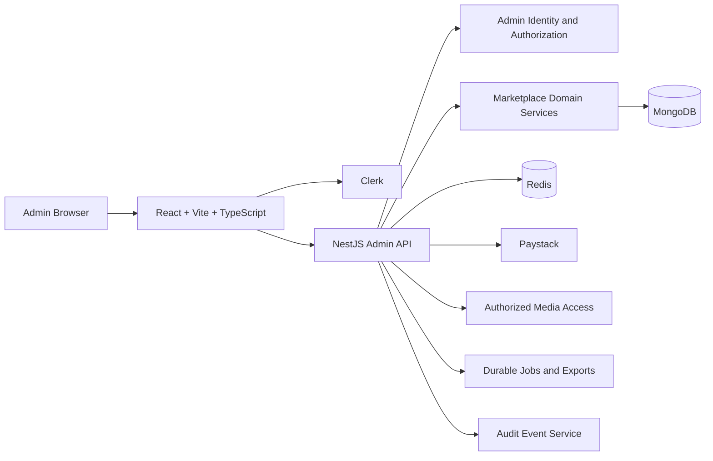

# Routic Admin Portal — Technical Architecture

## Confirmed stack direction
React + Vite + TypeScript; Refine preferred; NestJS + TypeScript API; MongoDB primary database; Redis for cache/coordination; Clerk identity and manual admin approval; Paystack payments. The portal must call NestJS APIs and must never connect directly to MongoDB.

## Logical architecture


## Frontend structure (suggested; inspect repository first)
```text
src/
  app/{providers,router,layouts,access-control}/
  features/{dashboard,users,verifications,vehicles,listings,bookings,rentals,incidents,disputes,finance,communications,notifications,reports,audit}/
  components/{data-table,filters,status,forms,dialogs,evidence-viewer}/
  lib/{api-client,auth,dates,currency,validation}/
```
Use Refine resources/data providers/access-control only after checking installed version and existing project conventions. Do not copy examples from incompatible major versions.

## Responsibilities
Frontend renders authoritative API data, handles UX validation, tables, filters, confirmations, reason capture and errors. NestJS owns authorization, business rules, state transitions, provider verification, audit and persistence. MongoDB is durable source of truth. Redis is not the authoritative record for bookings, money or audit. Long-running exports and notifications need durable jobs.

## Backend integration
Reuse existing domain services for users, listings, bookings, rentals, payments and disputes; do not duplicate domain rules in a separate admin-only service. Suggested API groups include `/admin/dashboard`, `/admin/users`, `/admin/verifications`, `/admin/listings`, `/admin/bookings`, `/admin/rentals`, `/admin/cases`, `/admin/transactions`, `/admin/communications`, `/admin/reports` and `/admin/audit-logs`. These are conceptual, not final routes.

## Clerk
Verify Clerk sessions/tokens server-side. Map verified subject to Routic admin identity. Enforce manual approval. Do not expose secret keys in Vite client variables. If webhooks are used, verify signatures and make processing idempotent. Ask how Clerk approval is represented, whether MFA is mandatory, session lifetime, and offboarding process.

## API and data standards
DTO validation; explicit response projections; server-side pagination/filtering; allowlisted sort/filter fields; stable error codes; request IDs; idempotency for side effects; no raw MongoDB documents. Do not expose stack traces or private provider payloads.

## Deployment
Separate local, staging and production credentials/configuration. Ask for hosting provider, admin domain, CI/CD, secrets manager, monitoring, backups, restore targets, job queue and budget before selecting services.

## Required ADRs
Refine version/integration; Clerk admin mapping; API conventions; pagination/search; queue/job provider; export generation and secure delivery; private evidence access; audit retention; financial operations after payment model approval.
